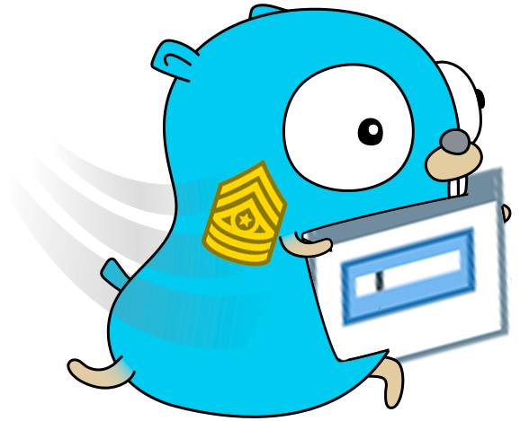
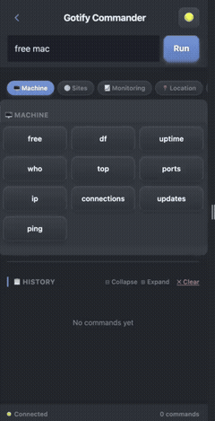
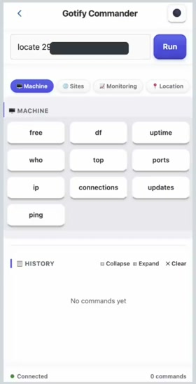
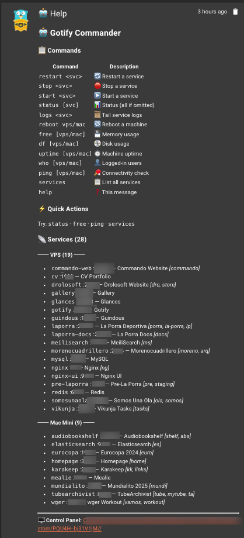
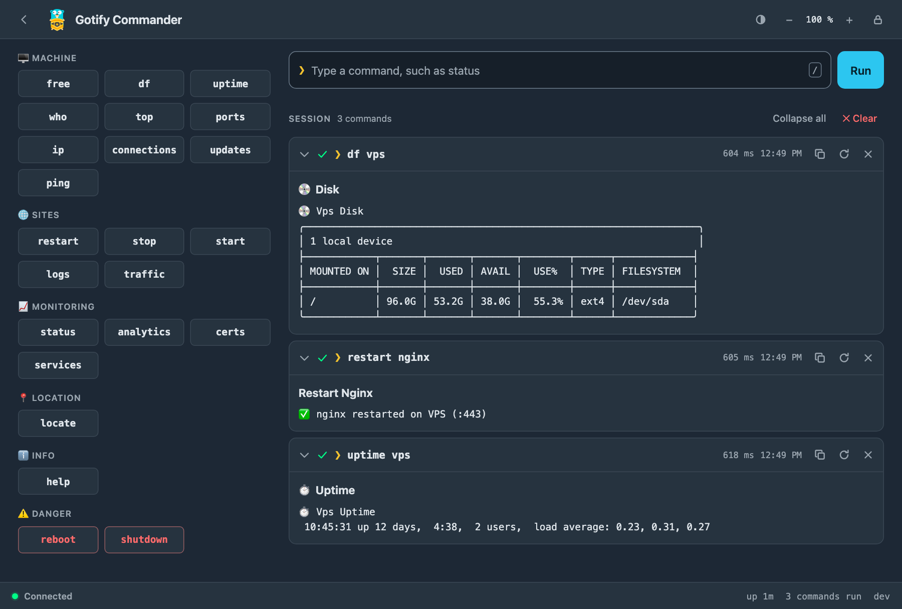

<p align="center"></p>

<h1 align="center">gotify-commander</h1>

<p align="center">
  <a href="https://gotify.net"></a>
  <a href="https://github.com/drolosoft/gotify-commander/actions/workflows/ci.yml"></a>
  <a href="LICENSE"></a>
  <a href="https://github.com/drolosoft/gotify-commander/releases"></a>
</p>

> **A remote control for your servers.** The first Gotify plugin that talks back.

You're at a cafe. Your phone buzzes -- a service is down. You tap `restart nginx`. Five seconds later: `nginx restarted`.

No laptop. No SSH. No terminal. Just your phone and the Gotify app you already use.

27 commands. A visual control panel. Multi-machine support. One YAML config. Every other Gotify plugin forwards notifications somewhere else. This one lets you act on them.

---

## 🎬 Demo

| Commands & Service Management | GPS Location |
|:---:|:---:|
|  | [](assets/demo-location.gif) |
| *Send commands, get results as notifications* | *Click to play* |

---

## ⚡ How It Works

```
Phone (Gotify app)
      |
      |  "restart nginx"
      v
  Gotify Server  <------------------------------+
      |                                          |
      v                                          |
gotify-commander plugin                    Web UI
      |                                    control panel
      +-- local: systemctl restart nginx   (VPS services)
      +-- SSH:   launchctl unload/load     (Mac services)
                            |
                            v
                      Response sent back
                            |
                            v
                  Phone notification
                  "Restart Nginx -- restarted on VPS (:80)"
```

Commands and responses flow through a **single unified Gotify app** -- no separate channels to manage. Send a command, get the reply as the next notification.

---

## 🚀 Quick Start

### Compatibility

A Go plugin loads only when it was built with the same Go version and the same module versions as the Gotify binary. Each release ships one file per Gotify version and architecture, checked against the server's `go.mod` before publishing.

| Gotify | amd64 | arm64 | armv7 |
|--------|-------|-------|-------|
| 3.1.1 (and 3.0.x) | `gotify-commander-linux-amd64-for-gotify-3.1.1.so` | `gotify-commander-linux-arm64-for-gotify-3.1.1.so` | `gotify-commander-linux-arm-7-for-gotify-3.1.1.so` |
| 2.9.1 | `gotify-commander-linux-amd64-for-gotify-2.9.1.so` | `gotify-commander-linux-arm64-for-gotify-2.9.1.so` | `gotify-commander-linux-arm-7-for-gotify-2.9.1.so` |

Other Gotify versions need their own build: `scripts/pin-gotify.sh <version>` and `make build-plugin GOTIFY_VERSION=<version>` (see Building from Source). The Android app must be 2.10.1 or newer to talk to Gotify 3.

Coming from Gotify 2.x or plugin 0.2.0: see [Upgrading from Gotify 2.x](doc/upgrading-from-2.x.md) for the new files, tokens, panel password and SSH host keys.

### Install on Gotify 3

1. Download the file for your Gotify version and architecture from [Releases](../../releases) and check its `.sha256`.
2. Copy it to Gotify's plugin directory (usually `/opt/gotify/data/plugins/`, or the `plugins` folder of your Docker data volume).
3. Restart Gotify: `sudo systemctl restart gotify` (or `docker compose restart gotify`).
4. In the Gotify WebUI, **Clients** -> **Create client**. Copy the token now: Gotify 3 shows tokens only once.
5. **Plugins** -> **gotify-commander**. Note the plugin's app ID on that page.
6. **Configure**: paste your YAML with `client_token` and `command_app_id`, then enable the plugin.
7. The plugin page now shows the control panel link and, if `web_password` is empty, the generated password. Copy it from there; it is not sent anywhere else.
8. Send `help` from the Gotify app on your phone.

On Gotify 3 the phone app posts commands with your client token and the app ID (`appid`), so no application token is needed. This also means every client token of your account can post into the command app: create as few as you need. Clients created with an inactivity expiry are deleted by Gotify when they go unused; the client you give the plugin must be created without one (the default), or the plugin loses its stream after the expiry.

### Docker Installation

If you run Gotify in Docker, mount the plugin into the container:

```yaml
# docker-compose.yml
services:
  gotify:
    image: gotify/server:3.1.1          # gotify/server-arm64:3.1.1 on arm64
    volumes:
      - ./gotify-data:/app/data
      - ./gotify-commander-linux-amd64-for-gotify-3.1.1.so:/app/data/plugins/gotify-commander.so:ro
    ports:
      - "2006:80"
```

Pin the image tag and pick the `.so` built for that tag. When you upgrade Gotify, download the matching plugin file as well; a mismatch shows up in the Gotify log as a plugin load error.

The same setup is what `test/e2e/smoke.sh` uses to check each release against Gotify 3.1.1 and 2.9.1.

---

## 📋 Command Reference

<p align="center">
  <picture>
    <source media="(prefers-color-scheme: light)" srcset="assets/help-light.png">
    <source media="(prefers-color-scheme: dark)" srcset="assets/help-dark.png">
    
  </picture>
</p>

### 🔧 Service Management (7)

| Command | Args | Description |
|---------|------|-------------|
| `status` | `[service]` | Status of all services, or a specific one |
| `restart` | `<service>` | Restart a service (supports aliases) |
| `start` | `<service>` | Start a service |
| `stop` | `<service>` | Stop a service |
| `logs` | `<service>` | Tail the last N lines of service logs |
| `services` | -- | List all managed services |
| `help` | -- | Show command reference |

### 🖥️ System Diagnostics (9)

| Command | Args | Description |
|---------|------|-------------|
| `free` | `[vps/mac]` | Memory usage |
| `df` | `[vps/mac]` | Disk usage (via duf) |
| `uptime` | `[vps/mac]` | System uptime + load average |
| `top` | `[vps/mac]` | Top processes by CPU/memory |
| `who` | `[vps/mac]` | Currently logged-in users |
| `ping` | `[vps/mac]` | Connectivity check |
| `ip` | `[vps/mac]` | IP addresses |
| `ports` | `[vps/mac]` | Listening ports |
| `connections` | `[vps/mac]` | Socket statistics |

### 📊 Monitoring & Analytics (4)

| Command | Args | Description |
|---------|------|-------------|
| `traffic` | `[service]` | Nginx traffic analysis via rhit (last 3 months) |
| `analytics` | -- | Web analytics summary via goaccess |
| `certs` | -- | SSL certificate expiry for all domains |
| `updates` | `[vps/mac]` | Pending system updates (apt, or softwareupdate on a Mac) |

### 📍 Location (1)

| Command | Args | Description |
|---------|------|-------------|
| `locate` | `<lat> <lon>` | GPS reverse geocoding via OpenStreetMap |

### 🧰 Operations (4)

| Command | Args | Description |
|---------|------|-------------|
| `failed` | `[vps/mac]` | Failed systemd units; on a macOS target it says it is not available |
| `health` | -- | One summary: mounts at 85 % or more, load, memory, failed units, certificates expiring within 14 days |
| `docker` | `ps [name]` / `restart <name>` / `logs <name>` | Containers listed in `docker.allowed_containers` only; `restart` counts as dangerous |
| `digest` | -- | The health summary now; with `digest.enabled` it also arrives every day at `digest.at` |

### ⚠️ Danger (2)

| Command | Args | Description |
|---------|------|-------------|
| `reboot` | `<vps/mac>` | Reboot a machine (requires explicit target) |
| `shutdown` | `<vps/mac>` | Shutdown a machine (requires explicit target) |

**Universal aliases:** `mem`/`memory` -> `free` -- `disk`/`space` -> `df` -- `log` -> `logs` -- `up` -> `uptime`

Typing just a service name (e.g. `nginx`) is treated as `status nginx`.

---

## 🖥️ Web UI Control Panel

<p align="center">
  <picture>
    <source media="(prefers-color-scheme: light)" srcset="assets/web-ui-light.png">
    <source media="(prefers-color-scheme: dark)" srcset="assets/web-ui-dark.png">
    
  </picture>
</p>

A console for your machines in the browser. The link is on the plugin page in Gotify (**Plugins** -> **gotify-commander**). It is one page with no framework and no third-party request, and it follows the light or dark theme of your system.

- ⌨️ A command line that suggests commands, machines, services and containers as you type. `Tab` completes, `Enter` runs, the up arrow brings back earlier commands, and `/` or `Ctrl+K` takes you there from anywhere
- 📂 Every command of your YAML categories one click away: beside the output on a wide screen, in tabs on a phone
- 🎯 Commands that need a machine or a service open a picker with your services grouped by machine, each with its favicon, description and port
- 📜 A session log with the state, the duration and the output of each command. Copy the output, run it again or remove it. Tables such as `df` keep their columns, and `help` is drawn as a table
- ⚠️ Dangerous commands, and the ones in `require_confirm`, ask in a dialog before they run
- 🟢 A status bar with the connection, the plugin's uptime, the commands it has run and its version
- 🔍 A page size control (50 % to 125 %) that the browser remembers
- 🔒 A padlock that forgets the password, for a screen you share
- 🕐 The session stays in the browser for 24 hours

Its keys, what it keeps in the browser, what it requests from other hosts, its API and how to work on it are in [The control panel](doc/control-panel.md).

The panel asks for a password the first time you open it in a tab. If `web_password` is empty, the plugin generates one when it is enabled, keeps it in its storage and shows it only on the plugin page in Gotify, under **Control panel password**. Set `web_password` to use your own; empty it to go back to the generated one. The browser keeps the password until the tab is closed.

The panel link contains the plugin token, which Gotify does not check, so the password is what protects the panel. The link is not sent in messages, printed by `help` or written to the log.

---

## ⚙️ Configuration

Configure via Gotify WebUI -- no config files to edit manually. See [`config.example.yaml`](config.example.yaml) for the full structure.

```yaml
gotify:
  server_url: "http://localhost:2006"
  base_url: "https://gotify.example.com"   # public URL of your Gotify server
  client_token: "your-client-token"        # from Gotify -> Clients
  command_app_id: 1                        # ID of the unified command/response app
  response_app_token: "your-token"         # token for the same app

web_password: ""   # empty = generated, shown on the plugin page in Gotify

defaults:
  timeout: 30s
  log_lines: 30
  rate_limit_per_minute: 20   # commands sent as messages; 0 = 20

# Categories -- tabs in the web UI
# type: machine (VPS/Mac buttons), service (service list), direct (runs immediately)
categories:
  - label: "Machine"
    type: machine
    commands: [free, df, uptime, who, top, ports, ip, connections, updates, ping]
  - label: "Sites"
    type: service
    commands: [restart, stop, start, logs, traffic]
  - label: "Monitoring"
    type: direct
    commands: [status, analytics, certs, services]
  - label: "Danger"
    type: machine
    danger: true
    commands: [reboot, shutdown]

services:
  nginx:
    description: "Web Server"
    domain: "example.com"
    machine: vps
    port: 80
    aliases: [ng, web]
    systemd: nginx

  homeserver:
    description: "Home Server"
    machine: mac
    port: 8080
    aliases: [home]
    launchd: com.myapp.service
```

Required fields per machine type:
- `machine: vps` -- requires `systemd` (unit name for `systemctl`)
- `machine: mac` -- requires `launchd` (label for `launchctl`) + SSH target configured

### Getting Your Gotify Tokens

1. **client_token**: Gotify WebUI -> **Clients** -> Create a new client -> copy the token. Gotify 3 shows it once; create the client without an inactivity expiry.
2. **command_app_id**: The plugin creates its own app (ID shown in Plugins page). Set this to that app's ID for unified commands + responses.
3. **response_app_token**: Deprecated and unused; leave it empty.

---

## 🌐 Multi-Machine

gotify-commander supports two machine types out of the box:

**VPS** -- commands run locally on the same server where Gotify is installed. Uses `systemctl` for service management.

**Mac** -- commands are sent over SSH to a remote Mac Mini or MacBook. Uses `launchctl` for service management.

```yaml
ssh_targets:
  mac:                            # must be named "mac" to auto-wire
    host: "100.x.x.x"            # Tailscale IP recommended
    port: 22
    user: "admin"
    key_file: "/home/admin/.ssh/id_rsa"
    known_hosts_file: "/home/admin/.ssh/known_hosts"   # optional, see below
```

Once configured, `free mac`, `df mac`, `uptime mac`, and services with `machine: mac` all route through SSH automatically.

macOS has no `free`, `ss`, `apt` or `journalctl`, so set `os: darwin` on a Mac target (the default is `linux`). The commands then run what a Mac has, with no shell in between, and the counting is done in Go:

| Command | On a Mac (`os: darwin`) |
|---------|-------------------------|
| `free mac` | `vm_stat`, shown as free, active, inactive and wired MiB |
| `top mac` | `ps -r -A -o pid,pcpu,pmem,comm`, first 10 lines |
| `ip mac` | `ipconfig getifaddr en0`, or the `ifconfig` addresses when en0 has none |
| `ports mac` | `lsof -iTCP -sTCP:LISTEN -P -n` |
| `connections mac` | `netstat -an -p tcp`, counted as established and listening |
| `restart` / `stop` / `start` | `launchctl kickstart -k` / `bootout` / `enable` + `kickstart -k` on `gui/<uid>/<label>` |
| `status` | the HTTP check on `port`, or `launchctl print gui/<uid>/<label>` without one |
| `logs` | `/usr/bin/log show --last 10m` for the process named by the last part of the label |

The service commands use launchctl on any `machine: mac` service, whatever `os` says, and the `<uid>` comes from one `id -u` on the first of them. A LaunchAgent stopped with `stop` is unloaded: `start` reports launchctl's error until you load it again on the Mac with `launchctl bootstrap gui/$(id -u) <plist>`. `updates mac` runs `softwareupdate -l`.

The plugin verifies the remote host key against `known_hosts`. By default it reads `~/.ssh/known_hosts` of the user that runs Gotify; when Gotify runs as a service or in Docker that file often does not exist, so set `known_hosts_file` or add the key first:

```bash
ssh-keyscan -p 22 100.x.x.x >> /home/admin/.ssh/known_hosts
```

Without a matching entry, commands to that machine fail with a host key error. There is no fallback to an unverified connection.

---

## 🔒 Security

**gotify-commander executes real system commands on your server.** Treat it with the same caution as SSH access.

To report a vulnerability, and for the threat model, see [SECURITY.md](SECURITY.md).

### Who Can Trigger Commands

- **Anyone who can send a message to the configured Gotify app** can execute commands. This includes Gotify users with access to that application, or anyone who obtains a valid app token.
- **Anyone with the web control panel password.** The page itself loads without it, but every API endpoint (`/execute`, `/health`, `/config`) needs `Authorization: Bearer <password>`. The password is `web_password`, or a random one generated by the plugin when that is empty (see the Web UI Control Panel section).
- `/execute` accepts only same-origin JSON requests up to 64 KiB, runs at most 2 commands at a time and 10 per minute.

### What Can Be Executed

- Only the **27 registered commands** can run. No arbitrary command execution.
- Service names are validated against `^[a-zA-Z0-9][a-zA-Z0-9._-]*$` and must match your configured whitelist.
- Commands run through `exec.Command` without a shell. The exceptions are two fixed scripts: one in `traffic` that filters the nginx logs, where the domain and the temp file path reach it as positional arguments, never as part of the script text, and `command -v docker`, which `docker` runs once to see whether docker is installed.
- `docker` only acts on the containers listed in `docker.allowed_containers`. The container name in the command line is always the one from the configuration, never the text you typed.
- Every command runs in its own process group with a timeout that kills the whole group, and its output is capped at 64 KiB.
- SSH targets are verified against `known_hosts`. Remote commands are quoted word by word.
- The plugin runs with the same permissions as the Gotify process plus the `sudo` rules you grant it. `config.example.yaml` ends with a minimal `sudoers` block listing the binaries the commands call.
- Commands sent as Gotify messages are limited to 20 per minute per plugin instance (`defaults.rate_limit_per_minute`). One over the limit is not run; the reply says how many seconds to wait. The control panel has its own 10 per minute, counted apart.
- `reboot`, `shutdown` and the commands of a `danger: true` category run one at a time, from messages and from the panel. A second one sent while the first is still running is refused.
- The panel keeps the command history in the browser's `localStorage` for 24 hours. The **✕ Clear** button removes it at once.
- Only Gotify administrators get a working plugin instance. For other users the plugin page shows a notice and nothing is started.
- `locate` sends the coordinates you type to the OpenStreetMap Nominatim service to get an address. The coordinates are not written to the plugin log, but they do leave your server.

### Confirmation by message (optional)

Commands sent as Gotify messages run at once by default. To have some of them ask first, list them in `require_confirm`:

```yaml
require_confirm: [reboot, shutdown, stop]
```

A `reboot vps` message then gets the reply "⚠️ Confirm `reboot vps`: reply `confirm 4821` within 60 s", and the reboot runs only when `confirm 4821` arrives in time. The code is random and works once. Only one command waits at a time: a new one replaces it and the reply says so. The `confirmation:` section changes the reply word (`keyword`), the text (`prompt`) and the time a code works (`window`); see `config.example.yaml`. This guards against a command sent by mistake, not against someone who holds a client token, because that person can read the reply too. The control panel asks in the browser either way.

### Hardening Recommendations

1. **Run Gotify behind a VPN** (Tailscale, WireGuard). Do not expose Gotify to the public internet. This is the single most important security measure.
2. **Set a strong Gotify admin password.**
3. **Keep the control panel password private.** Use the generated one or set a long `web_password`.
4. **Use HTTPS** for all Gotify traffic.
5. **Restrict Gotify app tokens.** Only create tokens for devices you control.

### 🛡️ Defense Layers

| Layer | Status |
|-------|--------|
| Command whitelist (27 commands) | ✅ Enforced |
| Input sanitization (regex) | ✅ Enforced |
| Service name whitelist | ✅ Enforced |
| Execution timeouts (30s default) | ✅ Enforced |
| Gotify authentication | ✅ Enforced (Gotify's own auth) |
| Web UI API authentication | ✅ Enforced (Bearer password, generated if `web_password` is empty) |
| Web UI security headers (CSP with nonce, no framing, no-store) | ✅ Enforced |
| Rate limiting | ✅ Web UI `/execute`: 2 at a time, 10 per minute. Messages: 20 per minute per instance. One dangerous command at a time |
| Panel history in the browser | ✅ Expires after 24 hours |
| Admin-only plugin instances | ✅ Enforced |
| Process group timeouts and 64 KiB output cap | ✅ Enforced |
| SSH host key verification | ✅ Enforced (`known_hosts`) |
| Per-command authorization | 🔲 Not implemented |

---

## 🏆 Comparison

| Feature | gotify-commander | Telegram Bots | Uptime Kuma |
|---------|:---:|:---:|:---:|
| 🏠 Self-hosted | ✅ | ❌ | ✅ |
| 🔄 Bidirectional | ✅ | ✅ | ❌ |
| 🔌 Runs inside Gotify | ✅ | ❌ | ❌ |
| 🚫 No third-party services | ✅ | ❌ | ✅ |
| 🔧 Service management | ✅ | ⚠️ varies | ❌ |
| 🌐 Multi-machine (SSH) | ✅ | ⚠️ varies | ❌ |
| 🖥️ Web control panel | ✅ | ❌ | ✅ |
| 📊 Traffic & analytics | ✅ | ❌ | ❌ |
| 📍 GPS locate | ✅ | ❌ | ❌ |
| 🔒 Tailscale security | ✅ | ❌ | ❌ |
| 📱 Phone app already installed | ✅ | ✅ | ❌ |

---

## 📦 External Dependencies

Some commands rely on utilities installed on the server. The plugin works without them, but those specific commands will fail.

| Command | Requires | Install | Notes |
|---------|----------|---------|-------|
| `df` | [duf](https://github.com/mdu-perrone/duf) | `apt install duf` | Required -- command fails if not installed |
| `traffic` | [rhit](https://github.com/Canop/rhit) | Download from [releases](https://github.com/Canop/rhit/releases) | Nginx log analyzer |
| `analytics` | [goaccess](https://goaccess.io/) | `apt install goaccess` | Web analytics from nginx logs |
| `locate` | outbound HTTPS to `nominatim.openstreetmap.org` | -- | Reverse geocoding, done in Go |
| `certs` | `openssl` | Pre-installed on most distros | Reads Let's Encrypt certificates |
| `ports` | `ss` | Part of `iproute2` | Socket statistics |
| `top` | `ps` | Part of `procps` | Process listing |
| `docker` | [Docker](https://docs.docker.com/engine/install/) | -- | The user that runs Gotify needs access to the Docker socket |
| `health` | `df`, `free`, `systemctl`, `openssl` | Pre-installed on most distros | Reads `/proc/loadavg`; certificates as `certs` does |

All other commands use standard Linux utilities (`systemctl`, `free`, `uptime`, `who`, `hostname`, `journalctl`, `zcat`, `grep`). `python3` is no longer needed.

## 🔨 Building from Source

The plugin has to be built with the same Go version and module versions as the Gotify server. The Makefile does that inside the official `gotify/build` Docker images, the same way the Gotify plugin template does, so you need Docker and nothing else.

```bash
git clone https://github.com/drolosoft/gotify-commander
cd gotify-commander
make build-plugin GOTIFY_VERSION=3.1.1 ARCH=amd64    # arm64 and arm-7 work too
sudo cp build/gotify-commander-linux-amd64-for-gotify-3.1.1.so /opt/gotify/data/plugins/gotify-commander.so
sudo systemctl restart gotify
```

`build-plugin` first pins `go.mod` to the server's versions (`scripts/pin-gotify.sh`), builds, and then runs `scripts/check-plugin-abi.sh`, which compares the Go version and every shared module in the `.so` against the server's `go.mod` and fails on any difference.

To work on the control panel you do not need Gotify or Docker. `make preview` serves the page on `http://127.0.0.1:8377` with a sample configuration and canned answers; no command is run on your machine. The page is in `web/` (`panel.html`, `panel.css`, `panel.js`).

```bash
make test                           # go test ./...
make lint                           # go vet
make pin GOTIFY_VERSION=3.0.0       # pin go.mod to another Gotify release
make build-all                      # {2.9.1, 3.1.1} x {amd64, arm64, arm-7} into build/
test/e2e/smoke.sh 3.1.1 build/gotify-commander-linux-amd64-for-gotify-3.1.1.so
```

The smoke test starts Gotify in Docker with the plugin mounted, sends `ping`, waits for `pong`, checks the panel authentication and restarts the server. A weekly workflow opens an issue when Gotify publishes a new release so the plugin can be rebuilt.

---

## 🤝 Contributing

Contributions are welcome -- bug fixes, new commands, feature ideas. Open an issue or submit a PR.

If gotify-commander made your server management easier, consider giving it a star on GitHub -- it helps others discover the project.

---

## ☕ Support

If gotify-commander gives you superpowers over your infrastructure, consider buying me a coffee -- it keeps the next one coming!

<p align="center">
<a href="https://buymeacoffee.com/juan.andres.morenorub.io"></a>
</p>

---

## 📄 License

**MIT License** -- free to use, modify, and distribute.

**[Drolosoft](https://drolosoft.com)** -- *Tools we wish existed*
