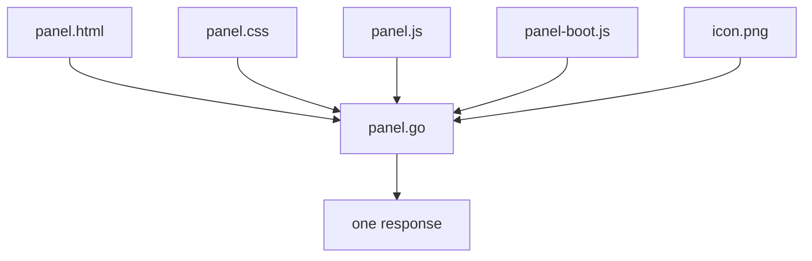

# The control panel

The control panel is a console for your machines in the browser: one page,
served by the plugin at its own path inside Gotify. The link is on the plugin
page (**Plugins** -> **gotify-commander** -> **Control Panel**), next to the
password it asks for.

This page describes how to use it, what it stores and requests, its API, and
how to work on it.

## Using it

The page has four parts:

- **The command line**, at the top. Type a command and press `Enter`.
- **The commands**, from the `categories` of your configuration: beside the
  output on a wide screen, in tabs on a phone.
- **The session**: every command that ran, newest first, with its output.
- **The status bar**, at the bottom: the connection, the plugin's uptime, the
  commands it has run and its version.

### The command line

It suggests as you type: first the commands, then what the command takes (a
machine, a service or an allowed container).

| Key | What it does |
|-----|--------------|
| `/` or `Ctrl+K` (`Cmd+K`) | Go to the command line from anywhere |
| `Down` / `Up` | Move through the suggestions. With none on screen and the line empty, walk the commands already run |
| `Tab` | Complete with the highlighted suggestion (the first one if none is) |
| `Enter` | Run the line, or the highlighted suggestion when it is complete |
| `Escape` | Close the suggestions, or the open picker |

`locate` alone asks the browser for its position and runs `locate <lat> <lon>`
with it.

### The commands

A command of a `direct` category runs at once. One of a `machine` or
`service` category first opens a picker under its group: the machines, or your
services grouped by machine with their favicon, description and port. With
nine services or more the picker has a box to filter them.

### The session

Each entry shows whether the command worked, how long it took and what it
answered. Its three buttons copy the output, run the command again and remove
the entry. Output laid out in columns (`df`, tables) scrolls sideways instead
of wrapping, and an answer written in Markdown (`help`, `locate`) is drawn as
headings, tables and links.

### Confirmation

The panel asks in a dialog, with **Cancel** focused, before:

- `reboot`, `shutdown` and `docker restart`;
- every command of a category with `danger: true`;
- every command listed in `require_confirm`.

### The top bar

- **Theme**: system, dark, light. The page follows the system until you pick
  one.
- **Page size**: smaller, the percentage (which goes back to 100 %) and
  larger, from 50 % to 125 %. The top bar itself does not change, so the
  buttons stay where they are, and the content keeps the window's width.
- **Padlock**: forgets the password and asks for it again, for a screen you
  share.

## What it stores in the browser

| Key | Where | What | For how long |
|-----|-------|------|--------------|
| `gc_token` | `sessionStorage` | The control panel password | Until the tab closes or you press the padlock |
| `gc_history` | `localStorage` | The last 30 commands with their output | 24 hours; **Clear** removes it now |
| `gc_theme` | `localStorage` | `dark` or `light`; nothing for system | Until you change it |
| `gc_zoom` | `localStorage` | The page size, when it is not 100 % | Until you change it |

Nothing is stored on the server for the panel except the generated password,
which lives in the plugin's storage.

## What it requests from other hosts

The page itself is one response: its stylesheet, scripts and icons are inside
it, and the API it calls is on the same origin. Two things come from
elsewhere, both as images:

- **Favicons.** For each service with a `domain`, the browser asks
  `https://<domain>/favicon.ico`. No `Referer` is sent.
- **The map tile of `locate`.** The answer ends with one tile from
  `tile.openstreetmap.org`. That server refuses a browser that sends no
  `Referer`, so this one request carries the origin of your Gotify (scheme
  and host, never the panel's path, which holds the plugin token).

An image from any other host in an answer is shown as a link and not
requested.

## API

Every route is under the plugin's path, `/plugin/<id>/custom/<token>/`. The
page and its icon need no password; the rest need
`Authorization: Bearer <password>` and answer `401` without it. The password
is never read from the URL.

| Route | Answer |
|-------|--------|
| `GET /` | The page |
| `GET /icon` | The icon, PNG |
| `GET /health` | `status`, `uptime`, `commands_executed`, `last_command`, `last_command_time`, `version`. `503` when the plugin is disabled |
| `GET /config` | `machines`, `services`, `categories`, `commands`, `containers` |
| `POST /execute` | Body `{"command": "restart nginx"}`. Answers `title`, `message` and `markdown`, or `error` |

`commands` lists the commands that are enabled, each with `name`, `usage`,
`summary`, `target` (`machine`, `service`, `container`, `coordinates` or
empty), `required` and `confirm`.

`POST /execute` must be `application/json` and come from the panel's own
origin. It runs two commands at a time and ten a minute; over that it answers
`429`.

## Working on it

The panel only runs inside Gotify, which needs Docker and a plugin built for
Linux. To see it without either:

```bash
make preview
```

It serves the page on `http://127.0.0.1:8377/plugin/1/custom/PLUGINTOKEN/`
(password `preview`) with a sample configuration and canned answers. No
command is run on your machine, except `locate`, which really asks the
geocoder. The service called `broken` always fails, to see a failed entry.
The files are embedded when the preview is built, so restart it after a
change.

### The files



| File | What |
|------|------|
| `web/panel.html` | The markup, with a `{{placeholder}}` where each other piece goes |
| `web/panel.css` | The only stylesheet. No framework |
| `web/panel.js` | The page's script |
| `web/panel-boot.js` | Runs in `<head>`: puts the stored theme and page size on `<html>` before the first paint |
| `web/icon.png`, `web/touch-icon.png` | The icons, inlined as `data:` URIs |
| `panel.go` | Embeds the files and puts the page together once, when the plugin loads |
| `preview_test.go` | The preview server, behind the `preview` build tag |
| `internal/command/catalog.go` | What the command line knows about each command |

### Rules the tests hold

The page is served with `default-src 'none'` and a nonce on its own `<script>`
and `<style>` blocks, with no `'unsafe-inline'`. The tests read the page's
source for what that policy would block, so in any file under `web/`:

- no `style` attribute, in the markup or built by the script;
- no inline event handler. The check looks for a space, `on`, letters and an
  equals sign, so a variable called `only` or `once` that is assigned fails
  it too;
- no `javascript:` URL, no `<script src>`, no stylesheet link, no `@import`;
- no text shaped like a placeholder of `panel.html`, two braces around a
  lower case name, except the placeholders themselves;
- no call to the browser's `confirm()`.

The script builds every element with `createElement`, never from a string of
HTML, so an answer cannot inject markup.

Three more things are checked:

- every registered command has an entry in `internal/command/catalog.go`,
  and the other way round;
- the page sizes are the same in `panel.js` (`ZOOM_STEPS`), in `panel.css`
  (one rule each) and in `panel-boot.js`;
- the session's 24 hours and the help text that tells the user about them.

### Colours and sizes

Every colour is a role in `panel.css` (`--bg`, `--text`, `--accent`,
`--danger`...) with a light and a dark value in one `light-dark()` call, so
the system theme needs no script. Each text colour was measured at 4.5:1 or
more against the surfaces it sits on; measure again when you change one.

Every size of the content is in `rem`. The page size control sets the
`font-size` of `<html>` through one factor, `--zoom`, and the content
follows.

Two things must not follow it, and they are sized in `--unit`, the `rem` of
the page at 100 %:

- **The top bar** and everything in it. Its buttons are what changes the
  size; sized in `rem` they would move at every click and the next click
  would land somewhere else.
- **The width the content may take.** Smaller text is for seeing more in the
  same window, not the same in a narrower column.

A new control in the top bar uses `calc(var(--unit) * N)`, never `rem` nor
the `--space-*` tokens. Rules that override a component inside the top bar
go in the `components` layer: a later layer wins whatever the selector.

### Adding a command

Register it as before, then describe it in `internal/command/catalog.go`: its
usage, a one-line summary and what it takes. The command line picks it up
from `GET /config`. A test fails while the entry is missing.
